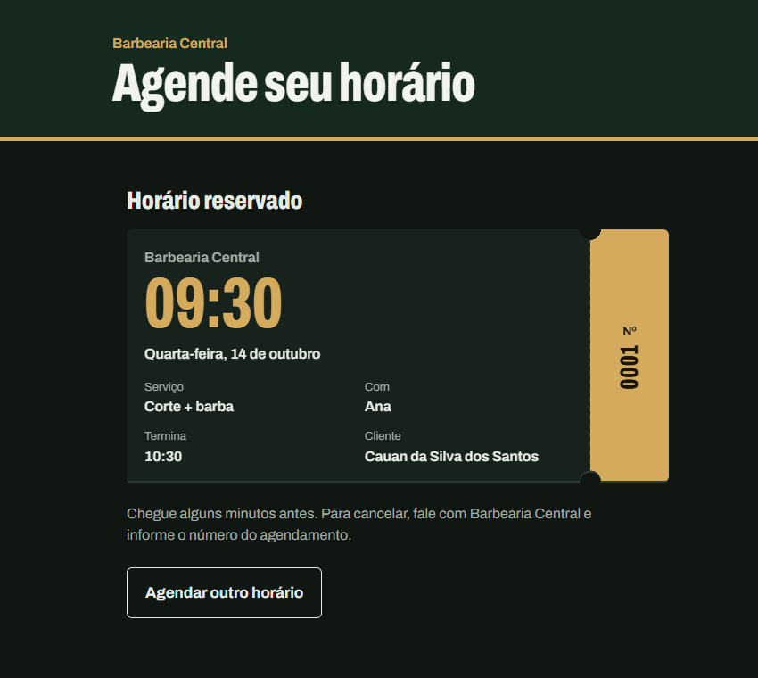

# Agendamento para pequenos negócios

[](https://github.com/Cauan-Silva/agendamento/actions/workflows/ci.yml)

Sistema de hora marcada para barbearias, salões, clínicas e outros negócios pequenos. O cliente escolhe o serviço, o profissional e o dia, vê só os horários realmente livres e recebe um comprovante. A equipe entra num painel para ver a agenda do dia e marcar atendimentos como concluídos ou cancelados.

<!-- Depois de publicar, troque pelo seu link: -->
<!-- **Ver online:** https://agendamento-xxxx.vercel.app (a API gratuita pode levar ~1 minuto para acordar no primeiro acesso) -->



## O que tem aqui

**Para o cliente**
- Serviço → profissional → dia → horário → nome, celular e e-mail (opcional) → comprovante
- Só aparecem horários realmente livres: fora do almoço, de folgas e de feriados
- Confirmação por e-mail na hora e lembrete na véspera
- **Cancelar ou remarcar sozinho:** o e-mail e o comprovante trazem um link pessoal para o cliente ver o horário, trocar por outro livre ou cancelar, sem login (até 2 horas antes, configurável)

**Para a equipe** (painel em `#/painel`, com login)
- **Um login para cada pessoa:** o administrador vê e altera tudo; o profissional vê e atualiza só a própria agenda. Cada um troca a própria senha, e o administrador cria, desativa e redefine senhas na tela **Acessos**
- **Agenda do dia** por profissional, com concluir, cancelar e um botão que abre o WhatsApp do cliente com o lembrete já escrito
- **Folgas e feriados:** bloqueios de dias inteiros ou de algumas horas, para uma pessoa ou para o negócio todo
- **Serviços e equipe:** cadastro, edição e desativação, incluindo dias de trabalho, expediente e intervalo de almoço
- **Relatório mensal:** faturado, previsto, cancelamentos, gráfico de atendimentos por dia e desempenho por profissional e por serviço

**Por baixo**
- **Sem horário duplicado:** a API recalcula a disponibilidade e trava o profissional no banco ao agendar; se duas pessoas tentam o mesmo horário, a segunda recebe `409` e a tela oferece outro
- **Faturamento confiável:** o preço é gravado no agendamento, então mudar o preço de um serviço não altera relatórios passados
- **Link do cliente seguro:** cada agendamento tem um código aleatório de 256 bits; o link não mostra telefone nem e-mail, caso seja encaminhado
- **Acesso revogado na hora:** a cada requisição a API confere no banco se o login continua ativo e qual é o perfil, então desativar alguém vale imediatamente, sem esperar o token expirar
- **Integração contínua:** a cada push, o GitHub Actions compila, roda os testes (incluindo um teste de integração com PostgreSQL de verdade) e faz o build do front-end

## Tecnologias

- **Back-end:** Java 21, Spring Boot 3.5 (Web, Data JPA, Validation, Security), JWT
- **Front-end:** React 19 com Vite
- **Banco:** PostgreSQL, com migrações via Flyway
- **Qualidade:** JUnit 5, Mockito, AssertJ e MockMvc; documentação com Swagger/OpenAPI; CI com GitHub Actions
- **Deploy:** Docker, Render (API), Neon (banco) e Vercel (front-end)

## Como rodar no seu computador

Pré-requisitos: JDK 21, Maven, Node.js e PostgreSQL (instalado ou via Docker).

### 1. Banco de dados

**Com PostgreSQL instalado** (porta 5432), crie o usuário e o banco uma vez:
```sql
CREATE USER agendamento WITH PASSWORD 'agendamento';
CREATE DATABASE agendamento OWNER agendamento;
```

**Ou com Docker** (porta 5433):
```bash
docker compose up -d
```

### 2. API

```bash
cd backend
mvn spring-boot:run                                  # PostgreSQL instalado
mvn spring-boot:run -Dspring-boot.run.profiles=docker  # banco do Docker
```

A API sobe em `http://localhost:8080`; a documentação interativa fica em `http://localhost:8080/swagger-ui.html`. As tabelas e alguns dados de exemplo (3 serviços e 2 profissionais) são criados automaticamente.

### 3. Front-end

Em outro terminal:
```bash
cd frontend
npm install
npm run dev
```

Abra `http://localhost:5173`. O painel fica em `http://localhost:5173/#/painel`, com o login padrão de desenvolvimento **admin@agendamento.local / admin123** (troque com `ADMIN_EMAIL` e `ADMIN_SENHA`).

### Testes

```bash
cd backend
mvn test
```

Os testes de unidade não precisam de banco. O teste de integração (`IntegracaoTest`) sobe a aplicação inteira e só roda quando `DB_URL` está definido, como na CI. Para rodá-lo na sua máquina, aponte para um banco vazio só de testes:

```bash
DB_URL=jdbc:postgresql://localhost:5432/agendamento_teste mvn test
```

## Endpoints

| Método | Rota | Acesso | Descrição |
|---|---|---|---|
| POST | `/api/auth/login` | público | Devolve o token JWT do painel, com o perfil |
| GET | `/api/auth/eu` | logado | Dados de quem está logado |
| PATCH | `/api/auth/senha` | logado | Troca a própria senha (pede a atual) |
| GET | `/api/servicos` | público | Lista serviços ativos |
| GET | `/api/profissionais` | público | Lista profissionais ativos |
| GET | `/api/disponibilidade?profissionalId=&servicoId=&data=` | público | Horários livres no dia |
| POST | `/api/agendamentos` | público | Cria agendamento (a resposta traz o `codigoAcesso` do link do cliente) |
| GET | `/api/meu-agendamento/{codigo}` | link do cliente | Consulta o próprio horário |
| PATCH | `/api/meu-agendamento/{codigo}/remarcar` | link do cliente | Troca para outro horário livre (mesmo profissional e serviço) |
| PATCH | `/api/meu-agendamento/{codigo}/cancelar` | link do cliente | Cancela |
| GET | `/api/agendamentos?data=&profissionalId=` | equipe | Agenda do dia (o profissional sempre recebe só a própria) |
| GET | `/api/agendamentos/{id}` | equipe | Detalha agendamento |
| PATCH | `/api/agendamentos/{id}/cancelar` | equipe | Cancela |
| PATCH | `/api/agendamentos/{id}/concluir` | equipe | Marca como concluído |
| POST/PUT/DELETE | `/api/servicos`, `/api/profissionais` | admin | Cadastro (DELETE desativa) |
| GET/POST | `/api/bloqueios` | admin | Lista bloqueios vigentes / cria folga ou feriado |
| DELETE | `/api/bloqueios/{id}` | admin | Remove bloqueio |
| GET | `/api/relatorios/mensal?ano=&mes=` | admin | Relatório do mês |
| GET/POST | `/api/usuarios` | admin | Lista / cria logins da equipe |
| PUT | `/api/usuarios/{id}` | admin | Edita nome, e-mail, perfil, profissional e ativo |
| PATCH | `/api/usuarios/{id}/senha` | admin | Define uma senha nova para alguém |

Rotas da equipe e de admin exigem `Authorization: Bearer <token>`; "equipe" vale para os dois perfis, e um profissional que tenta mexer no agendamento de outra pessoa recebe `404`. Erros seguem o padrão RFC 7807 (`application/problem+json`): 400 dados inválidos, 401 sem login, 403 perfil sem permissão, 404 não encontrado, 409 horário ocupado, 422 regra de negócio (fora do expediente, dia de folga etc.).

## Como funciona a disponibilidade

Para um profissional, um serviço e um dia, a API:

1. Verifica se o profissional trabalha naquele dia da semana.
2. Percorre o expediente em passos de 30 minutos (configurável em `agenda.intervalo-minutos`), considerando a duração do serviço.
3. Remove os horários que já passaram.
4. Remove os horários que caem no almoço ou em um bloqueio (folga da pessoa ou feriado do negócio).
5. Remove os horários que se sobrepõem a agendamentos não cancelados.

Ao criar um agendamento, tudo é verificado de novo no servidor, e a linha do profissional é bloqueada no banco (`SELECT ... FOR UPDATE`) durante a transação: a segunda requisição simultânea espera a primeira terminar e então recebe `409 Conflict`.

## Estrutura

```
backend/src/main/java/com/cauan/agendamento/
├── config/       # relógio, CORS, Swagger
├── controller/   # rotas REST
├── dto/          # objetos de entrada e saída
├── exception/    # exceções e tratamento de erros
├── model/        # entidades JPA
├── notificacao/  # e-mail de confirmação e lembrete diário
├── repository/   # acesso ao banco
├── security/     # login, JWT, regras de acesso
└── service/      # regras de negócio

frontend/src/
├── components/   # etapas do agendamento do cliente
├── painel/       # login, agenda, bloqueios, cadastros e relatório
├── services/     # chamadas à API e sessão
└── utils/        # datas, preços, telefone
```

## Publicar

O passo a passo para colocar tudo online de graça está em [docs/DEPLOY.md](docs/DEPLOY.md).

### E-mail (opcional)

Sem configuração, os e-mails aparecem apenas no log da API. Para enviar de verdade, defina as variáveis `SPRING_MAIL_HOST`, `SPRING_MAIL_PORT`, `SPRING_MAIL_USERNAME`, `SPRING_MAIL_PASSWORD` e `MAIL_REMETENTE` (detalhes em [docs/DEPLOY.md](docs/DEPLOY.md)). O lembrete roda todo dia às 18h para os agendamentos do dia seguinte. Os e-mails trazem o link para o cliente cancelar ou remarcar; defina `URL_SITE` com o endereço do front-end publicado para o link apontar para o lugar certo.

## Ideias para evoluir

- Envio automático pelo WhatsApp com a API oficial (WhatsApp Business)
- Exportar o relatório em planilha
- Profissional registrar as próprias folgas pelo painel
- Recuperação de senha por e-mail
